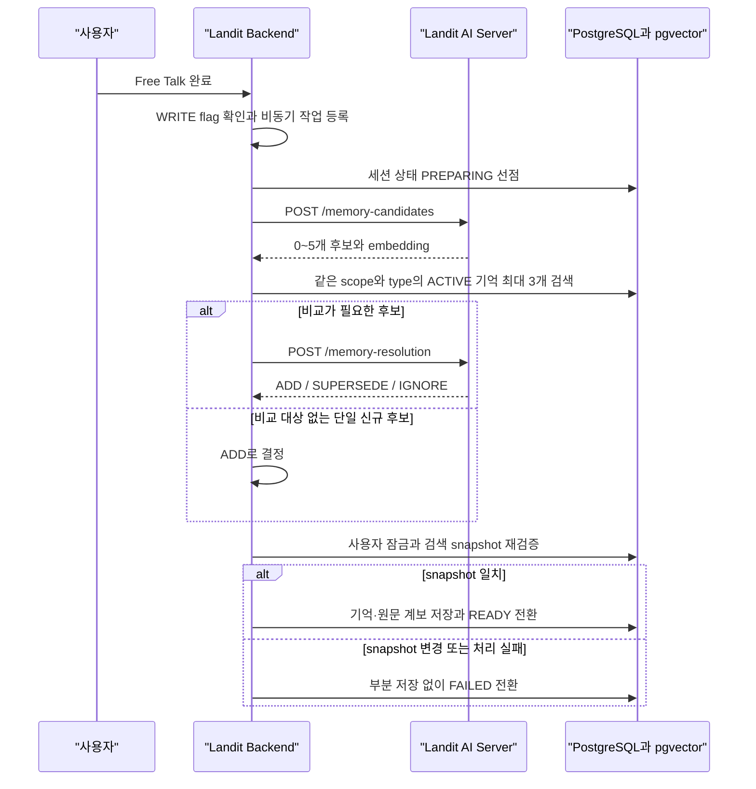
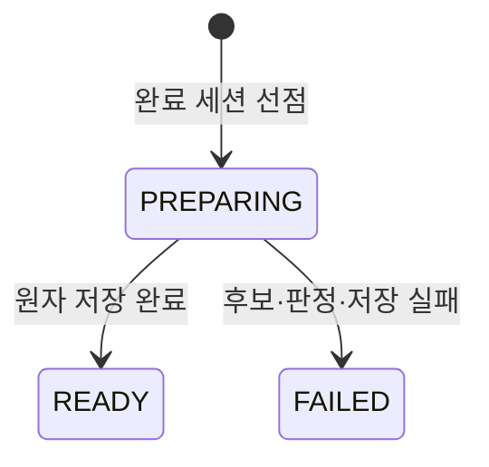
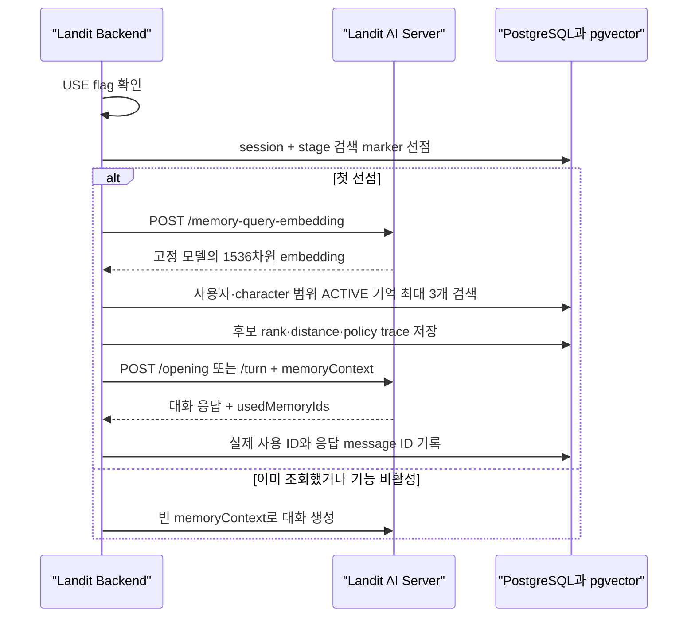
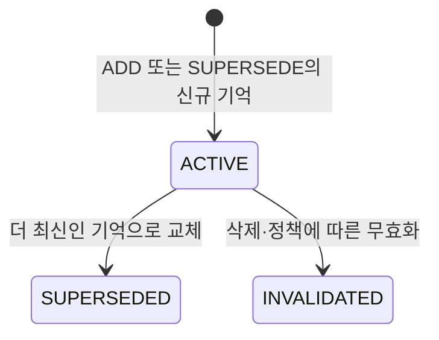

# Long-Term Memory Architecture

> 공개 이전: 2026-10-15. 원본은 `landit-ai.wiki`의 `5700ea1bb57a7c6293f99d2a8398735cfb1488be`이다. 본문에 적힌 기준일과 검증 범위를 유지한 스냅샷이며, 현재 배포 상태를 새로 확인한 문서는 아니다. 내부 링크는 공개 근거로 바꾸거나 비공개 참조로 표시했다.

장기기억은 완료된 Free Talk에서 다시 쓸 만한 사용자 사실을 추출하고, 다음 Free Talk의 첫 문맥에 선택적으로 제공하는 기능입니다. 이 문서는 AI API뿐 아니라 Landit Backend의 저장·검색·트랜잭션과 IaC 설정까지 한 흐름으로 설명합니다.

코드 기준은 AI `0376cf0`, Backend `a660c41`, IaC `6e85e5f`의 `origin/main`입니다. 전체 SHA는 Home (비공개 내부 문서)에 기록합니다. 아래 구조 확인은 운영 flag 활성화나 실제 기억 사용을 증명하지 않습니다.

**2026-09-28 부분 갱신:** 아래의 용어 설명, 출처 교정, 실패·재시도·시간 예산은 AI `c2ebd3268c329eb7fb677ca3cb00c66e10dd92f1` (비공개 원본 참조), BE `cfb15ec066277ed0baa255395c02c6c0500e99d7` (비공개 원본 참조)의 `origin/main`과 기존 테스트를 대조했습니다. 나머지 검색·rollout 설명의 기준은 위 커밋을 유지합니다. 이번 갱신은 테스트 실행이나 운영 동작 재검증을 포함하지 않습니다.

## 먼저 구분할 용어

대화에서 저장할 만한 사실을 **기억 후보**로 추출한 뒤, 이미 저장된 기억과 비교합니다. 후보를 만든 것과 DB에 기억을 저장한 것은 다른 단계입니다.

| 구분 | 값 | 의미 |
| --- | --- | --- |
| 후보에 대한 판정 | `ADD`, `SUPERSEDE`, `IGNORE` | 새로 저장, 기존 기억 대체, 저장하지 않음. |
| 세션의 생성 작업 상태 | `PREPARING`, `READY`, `FAILED` | 처리 중, 정상 완료, 생성·저장 실패. `READY`라도 저장할 기억이 0개일 수 있습니다. |
| 저장된 기억의 상태 | `ACTIVE`, `SUPERSEDED`, `INVALIDATED` | 사용 중, 다른 기억으로 대체됨, 무효화됨. |
| 저장 시도의 결과 | `STALE` | 판정 이후 비교 대상이 달라져 이번 저장을 거절함. 기억의 상태 이름이 아닙니다. |

예를 들어 새 발화가 기존 기억을 정정했다면 `SUPERSEDE`로 판정합니다. 저장에 성공하면 새 기억은 `ACTIVE`, 이전 기억은 `SUPERSEDED`, 생성 작업은 `READY`가 됩니다.

## 한눈에 보는 책임 경계

| 책임 | Landit Backend | Landit AI Server |
| --- | --- | --- |
| 세션·메시지 원본 | 조회·저장 | 요청으로 받은 문맥만 사용 |
| 기억 후보 생성 | 완료 세션 문맥 전달 | 후보 추출과 1536차원 임베딩 생성 |
| 중복·대체 판정 | 비교할 활성 기억 검색 | `ADD`, `SUPERSEDE`, `IGNORE` 판정 |
| 영속 상태 | DB 상태·원문 계보·트랜잭션 소유 | 저장하지 않음 |
| 다음 대화에서 사용 | 검색·`memoryContext` 구성·trace 저장 | 기억을 참고해 응답하고 `usedMemoryIds` 반환 |
| 기능 제어 | WRITE·USE flag 적용 | 별도 상태나 flag를 소유하지 않음 |

핵심 원칙은 [ADR 004](ADR-004-Backend-Owned-Long-Term-Memory.md)와 같습니다. AI 서버는 생성과 의미 판정에 집중하고, Backend가 권한·상태·동시성·감사를 책임집니다.

## 쓰기 흐름

### 1. 작업 시작

`LANDIT_MEMORY_WRITE_ENABLED`가 꺼져 있으면 완료 세션 뒤 작업을 등록하지 않습니다. 켜져 있으면 Backend의 `applicationTaskExecutor`가 비동기로 생성 작업을 실행합니다. 작업 등록이 거부되거나 실행 중 예외가 발생하면 세션의 기억 생성 상태를 `FAILED`로 정리하고, 사용자의 Free Talk 완료 응답에는 실패를 전파하지 않습니다.

생성 상태는 다음과 같습니다.

### 2. 후보 추출

Backend가 완료 세션의 USER 메시지, locale, character와 timezone을 `/memory-candidates`로 전달합니다. AI 서버는 `PROFILE`, `EVENT`, `EPISODE` 후보를 0~5개 반환합니다.

- `PROFILE`은 character와 무관한 사용자 특성이므로 `character_id`가 `NULL`입니다.
- `EVENT`와 `EPISODE`는 해당 Free Talk character 범위에 저장합니다.
- 후보는 USER 원문 `sourceMessageIds`를 하나 이상 가져야 합니다.
- 인사, 단순 동의, 일회성 요청, 학습 예문, 비밀·자격 증명·금융 식별자와 근거 없는 진단·성격·관계·의도 추론은 제외합니다.
- 임베딩은 `openai/text-embedding-3-small`, 1536차원 finite number로 고정합니다.

2026-09-28 기준 추출 버전은 `memory-candidate-v12`입니다. AI는 구조·출처를 검증한 뒤 원문 대조 검수(`KEEP`·`DROP`·`REFINE`)를 거쳐 최종 후보에만 임베딩을 생성합니다. 관계·동행자·학습 목적을 보존하되 원문에 없는 사실을 보완하지 않습니다. 개인의 사건 날짜를 뉴스·출시일에서 가져오거나 실제 친구·가족 대신 캐릭터를 참여자로 넣는 후보를 제외합니다.

출처 ID가 요청에 없거나 USER 메시지가 아니면 허용된 출처만 사용하도록 **한 번 재생성**합니다. 임의로 ID를 교체하거나 잘못된 후보를 그대로 통과시키지 않습니다. 교정 결과에도 구조·출처 검증과 원문 대조 검수를 다시 적용하며, 다시 실패하면 임베딩·저장 단계로 진행하지 않습니다. 이 교정도 같은 요청의 시간·호출 예산을 사용합니다.

상대 날짜는 각 USER 발화의 `occurredAt`을 요청 timezone으로 변환한 시각을 기준으로 해석합니다. 모호한 요일 표현은 추측하지 않습니다. 일부 검수 후보를 제외하는 것과 응답 전체의 schema·출처 계약 실패는 다릅니다. 검수 계약 실패 시 미검증 후보를 반환하지 않습니다.

### 3. 비교와 상태 판정

Backend는 후보별 임베딩으로 같은 사용자·scope·type의 `ACTIVE` 기억을 코사인 거리순 최대 3개 검색합니다. 비교 대상이 없는 단일 후보는 추가 AI 호출 없이 `ADD`로 처리할 수 있습니다. 그 외에는 후보와 비교 기억을 `/memory-resolution`에 전달합니다.

| operation | 의미 | 저장 결과 |
| --- | --- | --- |
| `ADD` | 독립된 새 사실 | 새 `ACTIVE` 기억 저장 |
| `SUPERSEDE` | 기존 사실을 새 사실이 대체 | 새 기억 저장 후 기존 기억을 `SUPERSEDED`로 전환 |
| `IGNORE` | 중복·일시적 발화·근거 부족 | 새 기억을 저장하지 않음 |

AI가 요청에 없는 후보나 기억 ID를 반환하거나, 하나의 기존 기억을 여러 후보가 동시에 대체하려 하면 해당 응답은 검증을 통과하지 못합니다. 중복 대체 오류에만 아래 정책에 따른 한 번의 교정을 허용하며, 최종 검증을 통과하지 않은 판정을 저장에 사용하지 않습니다.

Backend는 후보의 USER `sourceMessages`도 resolution에 전달합니다. AI는 기존 세부 정보를 지우는 일반화된 대체를 `IGNORE`로 바꾸며, 단일 기억의 명시적 정정에 대해서만 정확한 원문 인용을 검사해 예외를 허용합니다.

### 4. 원자 저장과 동시성

판정 이후에도 다른 작업이 같은 사용자의 기억을 바꿀 수 있습니다. Backend는 사용자 프로필 row를 잠근 뒤 비교 검색을 다시 실행하고, 판정 당시 snapshot과 ID·순서가 같은지 확인합니다.

- snapshot이 같을 때만 새 기억, 원문 계보, 기존 기억의 대체 상태와 세션 `READY`를 한 트랜잭션으로 반영합니다.
- snapshot이 달라지면 `STALE`로 보고 아무것도 저장하지 않은 뒤 생성 상태를 `FAILED`로 전환합니다.
- AI 응답의 일부만 골라 저장하지 않습니다. 쓰기 계약은 fail-closed입니다.

## 실패와 재시도 정책

**모델 호출의 재시도**, **출처·대체 판정의 교정**, **출력 형식 미지원 전환**은 서로 다릅니다. 모든 오류를 같은 요청으로 반복하지 않습니다.

| 상황 | 처리 |
| --- | --- |
| `finish_reason=length` 또는 native 종료 사유가 `max_output_tokens`·`max_tokens` | JSON 파싱 전에 `completion_token_limit`으로 실패합니다. 일부 내용이 유효한 JSON이어도 같은 요청을 반복하지 않습니다. |
| 일반 빈 본문·JSON 파싱·스키마 오류 | 후보 추출·상태 판정의 최초 요청은 설정된 최대 2회 시도 범위에서 복구합니다. 원문 대조 검수 등 모든 단계에 같은 재시도 횟수가 적용되는 것은 아닙니다. |
| 잘못된 후보 출처 ID | 출처 제한을 명시해 후보를 한 번 재생성하고 다시 검증합니다. 다른 계약 오류까지 이 경로로 복구하지 않습니다. |
| 여러 후보가 같은 기존 기억을 대체하려는 판정 | 중복 대체를 금지하는 지시를 추가해 한 번 교정합니다. 교정 결과에도 기존 검증을 적용합니다. |
| 출력 형식의 명시적인 미지원 오류 | `json_schema → json_object → 프롬프트 JSON`으로 전환합니다. 일반 timeout·인증 실패를 형식 미지원으로 취급하지 않습니다. 전환 후에도 도메인 검증을 통과해야 합니다. |
| 정상적인 `candidates: []` | 저장할 사실이 없는 정상 결과입니다. 생성 실패를 숨기기 위해 빈 목록을 만드는 fallback과 다릅니다. |
| 필수 후보 생성·검수·임베딩·판정 실패 | 미검증 후보나 부분 판정을 성공으로 반환하지 않습니다. BE 생성 작업은 실패 처리 경로로 진행합니다. |

교정 요청은 `max_attempts=1`이며 같은 교정을 반복하는 루프가 없습니다. 다만 한 번의 논리적 교정에서도 명시적 형식 미지원 전환으로 실제 HTTP 요청이 늘 수 있습니다. 아래 총 호출 상한이 함께 적용됩니다.

후속 질문은 선택 기능입니다. 후속 질문 생성만 실패하면 해당 기능의 fallback을 사용하며, 이미 검증된 기억 후보까지 무조건 버리는 것은 아닙니다. 기억 생성 작업의 실패도 완료된 프리톡 대화 자체를 실패로 바꾸지는 않습니다. 실패 상태 저장 자체가 실패한 경우는 별도 관측 대상입니다.

## 요청별 시간과 호출 예산

| 요청 | AI 내부 공유 예산 | 실제 외부 HTTP 호출 상한 | BE의 AI 응답 대기 제한 |
| --- | ---: | ---: | ---: |
| `/memory-candidates` | 50초 | 9회 | 55초 |
| `/memory-resolution` | 20초 | 7회 | 25초 |
| `/memory-query-embedding` | 위 두 생성 예산과 별도 | 위 상한에 포함하지 않음 | 2초 |

후보 요청에서는 추출·교정·검수·임베딩·후속 질문이 같은 예산을 사용합니다. 상태 판정의 교정도 원래 판정 요청의 예산을 공유합니다. 재시도나 출력 형식 전환은 예산을 새로 만들지 않습니다. 호출 상한은 평상시 호출 횟수나 모든 복구 경로를 끝까지 실행해 준다는 보장이 아닙니다.

각 외부 호출은 **남은 전체 시간, 호출당 20초, 호출자가 지정한 별도 제한 중 가장 짧은 값**을 사용합니다. 예를 들어 후보 생성에서 이미 42초를 썼다면 다음 호출에 남은 시간은 최대 8초이며, 더 짧은 개별 제한이 있으면 그것을 따릅니다. SDK 내부 자동 재시도는 끕니다.

시간 제한은 연결·읽기 timeout 설정만으로 처리하지 않습니다. 실제 HTTP 응답 본문을 읽는 구간에 별도 deadline을 적용해 조금씩 도착하는 응답이 대기를 계속 연장하지 못하게 합니다. 시간이나 호출 상한을 소진하면 새로운 외부 요청을 시작하지 않습니다.

이 값은 **각 API 요청의 외부 대기 경계**입니다. DB 검색·잠금·저장, 비동기 작업 대기까지 포함한 전체 기억 생성의 완료 시간 보장은 아닙니다. 50초나 20초가 모델의 평상시 응답 시간이라는 뜻도 아닙니다.

후보 추출과 원문 대조 검수는 `reasoning.effort=low`를 요청합니다. 기억 생성 흐름의 LLM 호출은 completion 한도 4,096을 요청하며, 추론 토큰이 예산을 소비해 최종 본문이 나오지 않을 수 있습니다. 이 설정만으로 의미 정확도나 생성 성공을 보장하지 않습니다.

### 실패 진단과 검증 위치

`memory_completion_attempts`는 최초 실패 사유와 시도별 종료 사유·토큰 수·경과 시간·허용된 generation/request ID를 남깁니다. 마지막 오류만 보고 최초의 출력 예산 소진이나 출처 오류를 놓치지 않도록 합니다. 원문 대화·프롬프트·모델 응답 전문은 로그에 추가하지 않습니다. 조사 순서는 [Troubleshooting](Troubleshooting-and-Observability.md#장기기억-생성과-사용)을 따릅니다.

| 근거 | 확인할 내용 |
| --- | --- |
| [memory_service.py](https://github.com/Aragornnnnnn/landit-tech-docs/blob/main/evidence/landit-ai/c2ebd3268c329eb7fb677ca3cb00c66e10dd92f1/app/free_talk/application/memory_service.py.md) | 출처·중복 대체 교정과 요청별 50초·20초 예산. |
| [json_completion.py](https://github.com/Aragornnnnnn/landit-tech-docs/blob/main/evidence/landit-ai/c2ebd3268c329eb7fb677ca3cb00c66e10dd92f1/app/free_talk/llm/json_completion.py.md), [completion_attempts.py](https://github.com/Aragornnnnnn/landit-tech-docs/blob/main/evidence/landit-ai/c2ebd3268c329eb7fb677ca3cb00c66e10dd92f1/app/free_talk/llm/completion_attempts.py.md) | 출력 형식 전환, 예산 소진 판별, 시도별 진단. |
| [request_budget.py](https://github.com/Aragornnnnnn/landit-tech-docs/blob/main/evidence/landit-ai/c2ebd3268c329eb7fb677ca3cb00c66e10dd92f1/app/core/request_budget.py.md), [RemoteAiMemoryClient](https://github.com/Aragornnnnnn/landit-tech-docs/blob/main/evidence/landit-be/cfb15ec066277ed0baa255395c02c6c0500e99d7/src/main/java/com/landit/landitbe/feature/memory/client/ai/RemoteAiMemoryClient.java.md) | 외부 호출 deadline과 BE 대기 제한. |
| [출력 예산 테스트](https://github.com/Aragornnnnnn/landit-tech-docs/blob/main/evidence/landit-ai/c2ebd3268c329eb7fb677ca3cb00c66e10dd92f1/tests/test_memory_completion_budget.py.md) | 잘린 응답 실패, 빈 본문과 정상 빈 목록 구분. |
| [출처 교정 테스트](https://github.com/Aragornnnnnn/landit-tech-docs/blob/main/evidence/landit-ai/c2ebd3268c329eb7fb677ca3cb00c66e10dd92f1/tests/test_memory_source_correction.py.md) | 한 번 교정, 재검증, 반복 실패 시 후속 처리 중단. |
| [HTTP 예산 테스트](https://github.com/Aragornnnnnn/landit-tech-docs/blob/main/evidence/landit-ai/c2ebd3268c329eb7fb677ca3cb00c66e10dd92f1/tests/test_memory_http_budget.py.md) | 느린 본문, 연속 호출·교정의 공유 예산, 호출 상한. |

## 읽기와 사용 흐름

### 검색 시점과 범위

검색 단계는 `OPENING`과 `FIRST_USER_TURN`입니다. 선택한 주제로 시작하면 opening에서, 사용자가 먼저 말해 주제가 아직 없으면 첫 USER turn에서 검색합니다. `free_talk_memory_retrieval`의 `(session, stage, rank)` 고유 제약과 rank 0 marker가 같은 단계의 중복 검색을 막습니다.

검색 조건은 다음과 같습니다.

- 해당 `user_profile_id`의 `ACTIVE` 기억만 조회합니다.
- `PROFILE`처럼 character 공통인 기억과 현재 character의 `EVENT`·`EPISODE`를 함께 검색할 수 있습니다.
- pgvector의 cosine distance 연산 `<=>`로 정렬하고 최대 3개만 전달합니다.
- 검색 정책은 `memory-retrieval-v2`이며 cosine distance가 `0.8` 이하인 결과만 최대 3개 전달합니다. query embedding의 Backend 요청 timeout은 2초입니다.
- AI 서버는 입력 `memoryContext` ID의 고유한 부분집합과 번역 응답의 구체 단어 겹침을 검사해 `usedMemoryIds`를 걸러냅니다. Backend도 ID 범위를 재검증하며 잘못된 목록은 사용 없음으로 정규화합니다. 이 trace는 의미적 사용 전체를 증명하지 않습니다.

### 기억 시간과 현재 사실의 구분

AI는 opening·turn마다 같은 서버 현재 시각으로 `validFrom`·`validTo`를 비교하고 `EXPIRED`, `NOT_YET_VALID`, `UNKNOWN`, `WITHIN_TIME_BOUNDS`를 prompt에 추가합니다. 만료된 직장·계획 등을 현재 사실로 답하지 않고 과거 정보로 구분하도록 지시합니다. 과거 회상은 허용하며, 유효 기간이나 예정일만으로 사건 발생을 확정하지 않습니다. 시간 상태는 계산 규칙이고 실제 문장의 시제·의미 준수는 별도 모델 품질 검증 대상입니다.

### 읽기 실패는 fail-open

검색어 임베딩, pgvector 검색 또는 후보 trace 저장이 실패해도 Free Talk 자체를 막지 않습니다. Backend는 `landit.memory.fallback{stage=...}` counter를 증가시키고 빈 `memoryContext`로 대화를 계속합니다. 응답 뒤 사용 trace 저장만 실패한 경우도 경고를 남기고 사용자 응답은 유지합니다.

쓰기의 fail-closed와 읽기의 fail-open을 혼동하지 않습니다.

| 경계 | 실패 정책 | 사용자 대화 영향 |
| --- | --- | --- |
| 후보·판정·원자 저장 | fail-closed | 완료된 대화는 유지하고 기억 생성만 `FAILED` |
| 검색·문맥 구성 | fail-open | 기억 없이 opening·turn 계속 |
| 사용 trace 기록 | fail-open | 생성된 응답 유지, 관측 데이터만 누락 가능 |

## 저장 구조와 상태

`conversation_memory`가 현재 기억 본문과 검색 벡터를 저장하고, `conversation_memory_source`가 기억의 근거 USER 메시지를 연결합니다.

주요 필드는 사용자·character 범위, `memory_type`, 본문·locale·confidence, 유효·관찰·기록 시각, 상태 전환 시각, extractor·embedding model과 `vector(1536)`입니다. `SUPERSEDED`는 대체한 기억을 가리키고, `INVALIDATED`는 무효화 사유를 가집니다.

`free_talk_memory_retrieval`은 세션·검색 단계, 후보 rank, cosine distance, policy version, 실제 사용 여부와 응답 message ID를 기록합니다. 이 trace는 “검색됨”과 “실제 생성에 사용됨”을 분리해 분석하기 위한 데이터입니다.

## Feature flag와 rollout 경계

| 환경변수 | Backend 기본값 | 역할 |
| --- | --- | --- |
| `LANDIT_MEMORY_WRITE_ENABLED` | `false` | 완료 세션 뒤 후보 생성·저장 작업 등록 |
| `LANDIT_MEMORY_USE_ENABLED` | `false` | 다음 Free Talk에서 검색·문맥 주입 |

두 flag는 분리되어 있어 먼저 쓰기와 데이터 품질을 검증한 뒤 사용을 활성화할 수 있습니다. IaC는 develop EC2 runtime env와 애플리케이션 플랫폼 설정에 두 값을 연결합니다. 코드 기본값이나 Terraform wiring만으로 특정 환경의 현재 활성 상태를 단정하지 말고, 배포된 runtime env와 대표 인증 E2E를 별도로 확인합니다. SSM 값 자체는 로그나 문서에 노출하지 않습니다.

## 관측과 품질 확인

한 요청을 조사할 때는 다음 증거를 연결합니다.

1. 세션의 `memory_generation_status`, `memory_generation_started_at`과 세션 완료 시각을 확인합니다.
2. 생성 실패라면 Backend의 후보 추출·판정·snapshot 재검증 로그를 확인합니다.
3. 사용 실패라면 `landit.memory.fallback`의 stage와 같은 시각의 AI·DB 오류를 확인합니다.
4. `free_talk_memory_retrieval`에서 검색 후보와 distance를 확인합니다.
5. `used=true`와 `response_message_id`로 실제 사용 여부를 구분합니다.
6. AI 로그·Sentry에는 기억 본문, 사용자 원문, prompt 전문과 embedding을 추가하지 않습니다.

현재 자동 검증은 계약·상태·검색·트랜잭션·trace의 정확성을 확인합니다. 기억을 쓴 대화가 실제로 더 자연스러운지는 별도의 승인된 평가 데이터와 rollout 지표가 필요한 제품 품질 문제입니다. 자세한 경계는 Quality Evaluation (비공개 내부 문서)을 확인합니다.

## 코드 지도

| 저장소 | 책임 | 주요 위치 |
| --- | --- | --- |
| `landit-ai` | 후보·resolution·query embedding·대화 사용 ID 계약 | `app/api/free_talk.py`, `app/models/free_talk.py`, `app/free_talk/application/memory_service.py`, `app/free_talk/application/embedding_service.py`, `app/free_talk/application/conversation_service.py` |
| `landit-ai` | API·안전 계약 테스트 | `tests/test_free_talk_api.py`, `tests/test_free_talk_rules.py`, `tests/test_memory_candidate_review.py`, `tests/test_memory_context_time.py` |
| `landit-be` | flag·비동기 생성·검색·원자 저장·trace | `config/memory/MemoryProperties.java`, `feature/memory/service/`, `feature/memory/repository/` |
| `landit-be` | AI client와 세션 연결 | `feature/session/client/ai/RemoteAiFreeTalkClient.java`, `feature/session/service/FreeTalkMemoryGenerationContextService.java` |
| `landit-be` | schema | `V65__add_conversation_memory.sql`, `V66__add_memory_generation_status.sql`, `V67__add_free_talk_memory_retrieval_trace.sql` |
| `landit-be` | 생성·검색·트랜잭션 테스트 | `FreeTalkMemoryGenerationServiceTest.java`, `FreeTalkMemoryRetrievalServiceTest.java`, `ConversationMemoryWriteServiceIntegrationTests.java`, `ConversationMemorySearchRepositoryIntegrationTests.java` |
| `landit-iac` | runtime flag 주입 | `environments/dev/templates/ec2-runtime-env.sh.tftpl`, `modules/app-platform/main.tf` |

API 필드 자체는 Free Talk API (비공개 내부 문서)를 기준으로 확인합니다. 장애 조사 순서는 [Troubleshooting and Observability](Troubleshooting-and-Observability.md#장기기억-생성과-사용)를 따릅니다.
