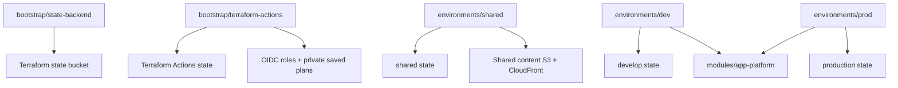
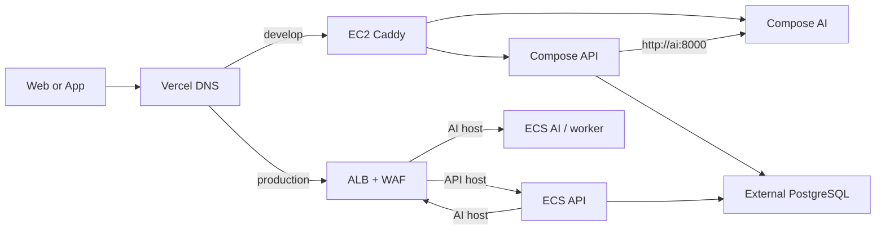
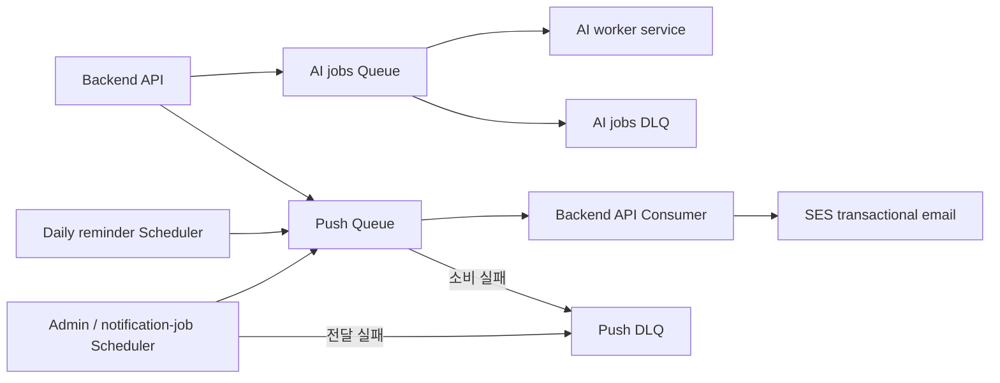
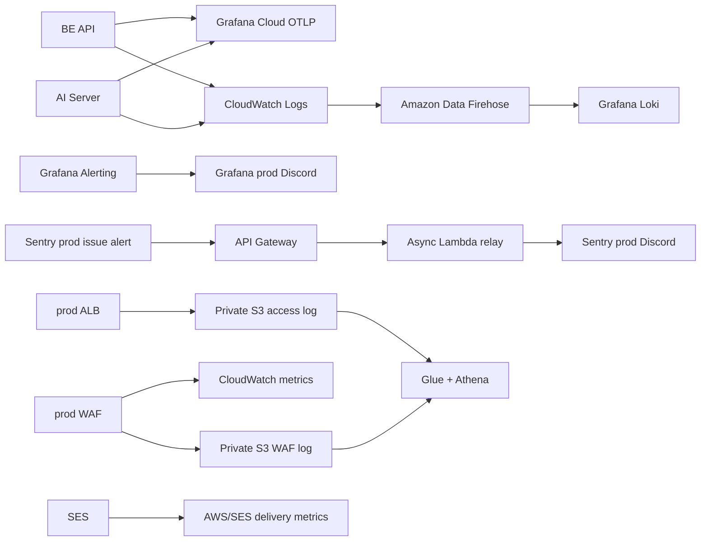
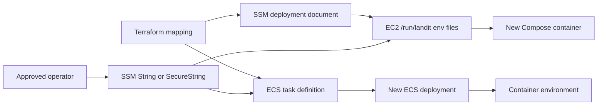

# Infrastructure Architecture

> 공개 이전: 2026-10-15. 원본은 `landit-iac.wiki`의 `3dd601a69d6cd66face489252793931ebf26cdb0`이다. 본문에 적힌 기준일과 검증 범위를 유지한 스냅샷이며, 현재 배포 상태를 새로 확인한 문서는 아니다. 내부 링크는 공개 근거로 바꾸거나 비공개 참조로 표시했다.

Landit IaC는 환경별 애플리케이션 플랫폼과 공통 콘텐츠 경로를 나눠 관리합니다. 같은 module을 쓰더라도 state와 실제 AWS 리소스는 환경별로 분리합니다.

## 책임 경계

| 영역 | IaC 책임 | 다른 저장소 또는 외부 책임 |
| --- | --- | --- |
| 요청 수신 | develop EC2·Caddy, production ALB·WAF | DNS record는 Vercel |
| 애플리케이션 실행 | develop Compose, production ECS, 공통 ECR | image build와 배포는 BE·AI workflow |
| 비동기 작업 | jobs Queue·DLQ, Push Queue·DLQ·Scheduler, SES | 메시지·예약 생성과 처리는 BE·AI 코드 |
| runtime 설정 | SSM 이름과 EC2 env·ECS 주입 | 실제 값 작성과 rotation은 Terraform 밖 |
| 관측성 | log group, Firehose, ALB log, WAF, Sentry relay | Grafana·Sentry live credential과 rule 운영 |
| 콘텐츠 | private shared S3, CloudFront OAC | DB URL 변경과 콘텐츠 생성 |

## Terraform root와 state

`bootstrap/state-backend`는 state bucket 자체를, `bootstrap/terraform-actions`는 OIDC와 배포 권한을 다룹니다. `shared`는 공통 콘텐츠를 소유합니다. develop은 공통 module에서 ECS·ALB를 끄고 별도 EC2 리소스와 SES identity를 관리합니다. production 발송 IAM은 이 identity를 참조하므로 개발 root의 identity 변경은 운영 발송에도 영향을 줍니다.

## 요청 경로

develop은 Caddy의 80·443 포트로 진입하고 API·AI의 host port는 loopback에만 노출합니다. production AI container port는 ALB 보안 그룹에서만 받지만 AI host 자체는 공개 주소입니다. BE 전용 토큰 인증의 단계적 활성화는 Secrets and Configuration (비공개 내부 문서)을 따릅니다.

production WAF는 Common Rule Set의 Count, IP Reputation 그룹의 기본 action, 특정 Common label의 Block, IP별 5분 2,000회 초과 Block으로 구성됩니다. 리소스 이름의 `count`만으로 차단 여부를 판단하지 않습니다. [규칙별 동작](Observability.md#waf-규칙과-로그)을 확인합니다.

코드 기본값은 develop `t3.small`, Compose API 메모리 768MiB·AI 1,024MiB, production AI worker 1 vCPU·2GiB입니다. 이 값은 실행 중인 리소스의 실측값과 구분합니다.

## 비동기 작업 경로

Push 전용 worker는 없습니다. develop EC2 API와 production ECS API가 각각 자기 환경의 Push Queue를 소비합니다. 일일 Scheduler는 dev·prod root 기본값이 `ENABLED`이며 매일 한국 시간 20시에 실행하도록 정의돼 있습니다. 관리자 예약과 체험 알림 예약은 BE가 같은 환경의 전용 그룹에 만들며 Terraform이 개별 예약을 소유하지 않습니다. 메시지 계약과 SES 발송 범위는 [Push and Email Notifications](Push-Notifications.md)를 확인합니다.

## 관측성과 장애 알림 경로

Grafana와 Sentry 알림은 조사 시작점입니다. 알림만으로 애플리케이션, provider, network 또는 인프라 원인을 확정하지 않습니다.

## 스토리지 경계

| 데이터 | 저장 위치 |
| --- | --- |
| 시나리오 썸네일과 연습 예문 이미지 | shared content bucket의 `content/` |
| 사용자 콘텐츠 | 환경별 application bucket의 `user-content/` |
| Firehose 전달 실패 데이터 | 환경별 application bucket의 `grafana-logs-failed/` |
| production ALB access log | 전용 private log bucket의 `alb/` |
| production WAF log | 전용 private WAF log bucket |

shared content bucket은 public access를 차단하고 CloudFront OAC로 `content/*`를 공개 조회합니다. API·배포 역할의 직접 접근은 허용된 prefix의 IAM 정책을 따릅니다.

## Runtime 설정 경로

SSM에 값을 만든 것만으로 container에 주입되지 않습니다. develop은 배포 문서·runtime-env 갱신 뒤 서비스를 배포하고, production은 task definition mapping과 새 ECS deployment를 확인합니다. 실행 중인 container는 바뀐 값을 자동으로 다시 읽지 않습니다.

## Terraform 밖의 책임

- Vercel의 DNS record.
- SSM actual value와 secret rotation.
- BE·AI image build, database migration과 애플리케이션 release.
- Grafana와 Sentry의 credential 발급.
- 공통 콘텐츠 object 업로드와 DB URL 변경.
- 장애 중 사용자 공지와 incident 의사결정.

경계를 넘는 변경은 해당 저장소와 운영 담당자의 절차를 함께 확인합니다.

기준 소스: 개발 root (비공개 원본 참조), 운영 root (비공개 원본 참조), application platform (비공개 원본 참조).
