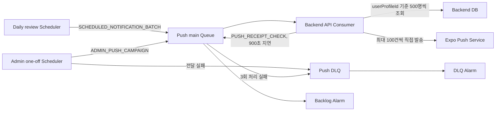

# Push and Email Notifications

> 공개 이전: 2026-10-15. 원본은 `landit-iac.wiki`의 `3dd601a69d6cd66face489252793931ebf26cdb0`이다. 본문에 적힌 기준일과 검증 범위를 유지한 스냅샷이며, 현재 배포 상태를 새로 확인한 문서는 아니다. 내부 링크는 공개 근거로 바꾸거나 비공개 참조로 표시했다.


Push 알림 인프라는 환경별 SQS Queue·DLQ, EventBridge Scheduler와 CloudWatch Alarm으로 구성됩니다. 별도 Push worker를 만들지 않고 develop EC2 API와 production ECS API의 Consumer가 자기 환경 main Queue를 처리합니다. SES 이메일과 체험 알림 예약도 같은 API 런타임의 권한·설정으로 준비합니다.

## 책임 범위

| 구성 | 책임 |
| --- | --- |
| Push main Queue와 DLQ | Terraform |
| Queue 소비 권한과 API 환경변수 | Terraform |
| Review reminder Scheduler | Terraform |
| Backlog·DLQ Alarm 상태 | Terraform |
| 최신 DB 기준 대상 계산, 멱등 처리와 Push 발송 | Landit Backend |
| 관리자·체험 알림 일회성 예약 | 그룹·IAM은 Terraform, 개별 예약과 메시지는 Backend |
| SES 발신 domain·configuration set·IAM | Terraform, DNS 인증과 발송 채널 제어는 별도 운영 |

기존 AI jobs Queue·DLQ와 AI worker는 Push 흐름에 참여하지 않습니다.

## 메시지 흐름



Scheduler는 사용자별 대상이나 Push token을 알지 않습니다. 일일 알림의 운영 계약은 `SCHEDULED_NOTIFICATION_BATCH`와 `PUSH_RECEIPT_CHECK`이며 관리자 예약에는 `ADMIN_PUSH_CAMPAIGN`을 사용합니다. 일일 예약 배치를 받으면 `occurredAt`과 `userProfileId` Keyset Pagination을 기준으로 사용자 500명씩 최신 대상을 계산하고, Expo API에 최대 100건씩 직접 발송합니다. `PUSH_SEND` 메시지와 별도 대상 배치 Queue는 사용하지 않습니다.

SQS Standard Queue의 중복 전달과 순서 변경을 전제로 처리합니다. 정기 알림의 Backend 이벤트 키는 `scheduled:{예정 시각의 KST 날짜}:{userProfileId}`, 발송 이력 키는 `push:{eventId}:{userPushTokenId}`입니다. **알림 유형과 Scheduler 실행 시도 ID는 이 키에 포함되지 않습니다.** 일반 알림과 관리자 공지의 재시도 정책은 다르며 외부 서비스까지 exactly-once 발송을 보장하지 않습니다. 상태·선점·재시도·Receipt 복구는 [BE 푸시 발송 정책](https://github.com/Aragornnnnnn/landit-tech-docs/blob/main/backend/Push-Delivery-Policy.md)을 따릅니다.

이 단락은 2026-09-28에 BE `cfb15ec` (비공개 원본 참조) 기준으로 갱신했습니다. 나머지 인프라 설명은 Home (비공개 내부 문서)의 기존 기준을 유지하며, 이번에 AWS 설정이나 운영 발송을 재검증한 것은 아닙니다.

## Queue와 DLQ

| 항목 | Main Queue | DLQ |
| --- | --- | --- |
| 이름 | `{prefix}-push-notifications` | `{prefix}-push-notifications-dlq` |
| 보관 기간 | 4일 | 14일 |
| Visibility timeout | 300초 | 해당 없음 |
| Redrive | 3회 처리 실패 뒤 DLQ | 해당 없음 |

production API Task Role과 develop EC2 instance role이 각각 main Queue의 수신, 삭제, visibility 변경, attribute 조회와 발행 권한을 가집니다. 관리자·알림용 일회성 Scheduler 실행 역할은 자기 환경 main Queue와 전달 실패 보관용 DLQ에만 발행할 수 있습니다.

## Scheduler 메시지 계약

Scheduler는 다음 JSON 메시지 1건을 발행합니다.

```json
{
  "version": 1,
  "messageId": "<aws.scheduler.execution-id>",
  "messageType": "SCHEDULED_NOTIFICATION_BATCH",
  "occurredAt": "<aws.scheduler.scheduled-time>",
  "payload": {}
}
```

| 필드 | 타입 | 계약 |
| --- | --- | --- |
| `version` | number | 반드시 `1` |
| `messageId` | string | Scheduler 실행 시도 식별자 |
| `messageType` | string | 반드시 `SCHEDULED_NOTIFICATION_BATCH` |
| `occurredAt` | string | ISO-8601 UTC 시각이며 Backend에서 `Instant`로 처리 |
| `payload` | object | 현재 빈 객체이며 기준 날짜는 `occurredAt`을 `Asia/Seoul`로 변환해 계산 |

`execution-id`는 실행 시도별 식별자이므로 최종 발송 멱등성 키로 사용하지 않습니다.

Terraform에서는 context token을 `jsonencode`로 만들지 않고 raw JSON heredoc을 사용합니다. `jsonencode`가 `<`와 `>`를 Unicode escape로 바꾸면 AWS의 정확한 context token 치환 여부가 불명확해지기 때문입니다. Plan 결과와 실제 Scheduler `Target.Input`에서 두 token이 꺾쇠를 포함한 원문으로 유지되는지 확인합니다.

## Scheduler 상태와 변경 조건

| 환경 | Prefix | 일정 | origin/main root 기본값 |
| --- | --- | --- | --- |
| develop | `develop-landit` | 매일 20시, `Asia/Seoul` | `ENABLED` |
| production | `prod-landit` | 매일 20시, `Asia/Seoul` | `ENABLED` |

일정은 `cron(0 20 * * ? *)`입니다. 재사용 module 자체의 기본값은 `false`지만 dev·prod root가 `true`를 전달합니다. 20시는 배치 시작 시각이며 실제 발송 완료 시각이 아닙니다. 이 표는 코드 기본값이고 현재 Scheduler state·실제 수신 결과는 별도 확인해야 합니다.

활성화 상태를 바꾸거나 Consumer를 교체할 때는 실제 Scheduler state와 기존 배포를 확인합니다. 500명 페이지·최대 100건 발송, visibility 연장, Receipt 900초 지연과 멱등성 계약을 검증하고 요청 범위만 포함한 plan을 승인받습니다. 이미 활성화된 Scheduler를 초기 설치 문서에 맞춰 임의로 끄지 않습니다.

main Queue visibility timeout은 현재 300초로 유지합니다. Consumer는 Handler가 정상 반환한 뒤 메시지를 삭제하고 예외가 발생하면 재전달받습니다. 전체 배치 시간은 `ceil(대상 사용자 수 / 500) × (페이지 일괄 조회 + 후보 계산 + Expo 최대 100건 단위 발송 시간)`입니다. 한 배치의 전체 처리 시간이 300초를 넘을 수 있으므로 Backend가 배치 시작과 각 페이지 처리 전후에 현재 메시지의 visibility를 연장하는 계약을 유지해야 합니다.

## API 환경변수

| 환경변수 | develop | production | 관리 방식 |
| --- | --- | --- | --- |
| `LANDIT_NOTIFICATION_CONSUMER_ENABLED` | `true` | `true` | 개발 API env·운영 ECS environment |
| `SQS_PUSH_NOTIFICATIONS_QUEUE_URL` | Queue URL | Queue URL | Terraform 참조를 API env·ECS에 주입 |
| `LANDIT_NOTIFICATION_TEST_API_ENABLED` | `true` | 주입하지 않음 | 개발 API env만 주입 |
| `LANDIT_NOTIFICATION_EXPO_BASE_URL` | Backend 기본값 | Backend 기본값 | 별도 주입 불필요 |
| `LANDIT_NOTIFICATION_CONNECT_TIMEOUT` | Backend 기본값 `5s` | Backend 기본값 `5s` | 별도 주입 불필요 |
| `LANDIT_NOTIFICATION_REQUEST_TIMEOUT` | Backend 기본값 `10s` | Backend 기본값 `10s` | 별도 주입 불필요 |
| `LANDIT_NOTIFICATION_RECEIPT_DELAY_SECONDS` | Backend 기본값 `900` | Backend 기본값 `900` | 별도 주입 불필요 |
| `LANDIT_NOTIFICATION_EXPO_ACCESS_TOKEN` | 선택 | 선택 | 사용할 때만 SSM SecureString |

`LANDIT_NOTIFICATION_EXPO_ACCESS_TOKEN`은 Expo의 추가 보안을 활성화할 때만 필요합니다. 기본 Expo Push Service 호출에는 없어도 되며, 사용하기로 결정하면 일반 Terraform 변수나 문서에 값을 남기지 않고 SSM SecureString으로 주입합니다. 수신 기기별 `ExpoPushToken`은 이 서버 환경변수와 별개이며 실제 알림 발송에 필요합니다. 자세한 내용은 [Expo Push Service 추가 보안](https://docs.expo.dev/push-notifications/sending-notifications/#additional-security)을 참고합니다.

## 관리자 일회성 예약과 혼합 DLQ

환경별 `{prefix}-admin-push` 그룹과 `{prefix}-admin-push-scheduler` 실행 역할을 사용합니다. 기존 일일 예약은 default 그룹에 남습니다. Backend가 `admin-push-{campaignId}`를 한국 시간 `at(...)`, flexible window OFF, 완료 후 DELETE로 만들며 개별 예약은 Terraform 관리 대상이 아닙니다.

- API는 자기 그룹의 `admin-push-*`에만 Create/Get/Delete 권한을 가집니다. PassRole은 전용 역할과 `scheduler.amazonaws.com`으로 제한합니다.
- 실행 역할의 trust는 자기 계정·그룹으로 제한합니다. main Queue와 기존 Push DLQ에만 SendMessage를 허용합니다.
- `LANDIT_PUSH_SCHEDULER_GROUP`, `LANDIT_PUSH_SCHEDULER_QUEUE_ARN`, `LANDIT_PUSH_SCHEDULER_ROLE_ARN`, `LANDIT_PUSH_SCHEDULER_DLQ_ARN`은 Terraform 참조로 주입하며 별도 SSM 값은 만들지 않습니다.
- 대상 SQL의 `LANDIT_PUSH_AUDIENCE_DB_*` 세 값은 기존 `DB_*`와 별도 `SecureString`입니다. 읽기 전용 계정과 session pooler 5432·`sslmode=require` 계약을 사용하며 AI에는 주입하지 않습니다.

기존 Push DLQ에는 Consumer 처리 실패와 Scheduler 전달 실패가 함께 들어갑니다. `SCHEDULE_ARN`, `ERROR_CODE` 등 Scheduler 오류 속성이 있는지 먼저 구분합니다. API 소비 역할에 DLQ 접근 권한을 추가한 구성은 아닙니다.

복구는 캠페인 상태와 원본 Target Input을 확인한 단건만 대상으로 합니다. CANCELLED·COMPLETED 캠페인의 발송을 복제하지 않고, Scheduler envelope를 그대로 main Queue에 보내거나 혼합 DLQ 전체를 redrive하지 않습니다. 상세 승인·복구 절차는 [소스 Runbook](https://github.com/Aragornnnnnn/landit-tech-docs/blob/main/evidence/landit-iac/6e85e5f70b61919fb89fc777c10699eb9549a9a5/docs/push-notifications.md.md#source-lan-462-dlq-단건-복구-절차)을 따릅니다.

## SES와 체험 종료 알림

| 항목 | 코드 구성 |
| --- | --- |
| 발신 identity | `landit.im`, 개발 root에서 한 번만 소유하고 운영도 참조 |
| 발신 주소 | `Landit <no-reply@landit.im>` |
| Configuration set | `develop-landit-transactional`, `prod-landit-transactional` |
| 발송 권한 | 환경별 API 역할의 `ses:SendEmail`, 해당 identity·configuration set과 발신 주소로 제한 |
| 반송·불만 | BOUNCE·COMPLAINT suppression |
| 전달 지표 | `AWS/SES`, `Environment=develop` 또는 `prod`, SEND·DELIVERY·BOUNCE·COMPLAINT·REJECT·DELIVERY_DELAY |
| 예약 권한 | 기존 admin-push 그룹의 `notification-job-*` Create/Get, 기존 PassRole 재사용 |

DNS 인증 레코드는 Vercel에서 관리합니다. 서울 리전 SES production access와 identity·DKIM 상태는 발송 전에 조회합니다. configuration set은 집계 지표를 제공하며 개별 메일 이벤트 소비자나 알림 수신처를 추가하지 않습니다.

API 런타임에는 `LANDIT_EMAIL_FROM`, `LANDIT_EMAIL_CONFIGURATION_SET`, `LANDIT_TRIAL_REMINDER_SANDBOX_ENABLED`를 일반 환경변수로 전달합니다. 체험 알림 sandbox 허용은 개발 `true`, 운영 `false`입니다. 연간 상품 목록 `LANDIT_TRIAL_REMINDER_ANNUAL_PRODUCT_IDS`는 환경별 SSM `String`에서 읽습니다. 이는 RevenueCat sandbox 이벤트 적용 플래그와 별개입니다.

이메일 발송·자동 체험 알림의 ON/OFF는 Backend DB 채널 설정에서 관리합니다. 중복 환경변수 스위치를 추가하지 않습니다. 실제 예약 시각·대상 판단·발송 시 재확인·멱등 처리는 BE 책임이며 IaC 권한이나 env 연결만으로 자동 알림이 완성됐다고 판단하지 않습니다.

[2026-09-16 LAN-505 기록](https://github.com/Aragornnnnnn/landit-tech-docs/blob/main/evidence/landit-iac/6e85e5f70b61919fb89fc777c10699eb9549a9a5/docs/tasks/LAN-505/plan.md.md)에는 SES 인증·production access 승인, 직접 테스트 메일 수신, 운영 SES·IAM과 API env 적용, 후속 timeout 적용과 전체 plan `No changes`가 기록돼 있습니다. 이는 해당 날짜의 인프라 검증이며 새 BE 알림 코드·마이그레이션 배포와 자동 알림 종단 검증은 포함하지 않습니다. 개발 runtime-env·SSM 배포 문서 반영도 별도 BE 개발 배포가 필요하다고 기록돼 있습니다.

발송 확인은 BE 접수, SES 접수, 전달 지표와 실제 메일함 수신을 구분합니다. `ACCEPTED`는 최종 수신 성공이 아닙니다. Apple 비공개 릴레이 주소는 발신 도메인 등록 상태도 별도로 확인합니다.

## 배포와 검증 순서

1. SSM 필수 이름·타입과 관리자 읽기 DB 권한을 준비하고 기존 Scheduler·실행 이미지 상태를 확인합니다.
2. Queue·IAM·그룹·SES·runtime mapping plan에서 요청 범위를 검토합니다. 운영은 현재 API·AI digest를 고정합니다.
3. 승인된 plan을 적용합니다. 개발은 갱신된 SSM 배포 문서로 API를 배포하고, 운영은 새 task definition을 service에 반영합니다.
4. 호환 BE 코드와 필요한 DB 마이그레이션·채널 설정을 별도로 확인합니다. IAM·env 배포를 애플리케이션 기능 배포와 구분합니다.
5. 제한된 테스트 대상으로 관리자 예약 생성·취소·실행, Scheduler DLQ 연결, Queue 소비, Push 기기 수신과 이메일 수신을 각각 확인합니다.

요청하지 않은 ECS Service delete·replace, 별도 Push worker 생성, AI worker와 기존 jobs Queue·DLQ 변경이 있으면 plan을 재검토합니다.

## Live 검증

Queue URL은 해당 root의 Terraform output으로 확인합니다.

```bash
LAN184_ROOT=environments/prod
LAN184_PREFIX=prod-landit

AWS_PROFILE=landit AWS_REGION=ap-northeast-2 \
  aws sqs get-queue-attributes \
  --queue-url "$(AWS_PROFILE=landit terraform -chdir="$LAN184_ROOT" output -raw push_notifications_queue_url)" \
  --attribute-names VisibilityTimeout MessageRetentionPeriod RedrivePolicy ApproximateNumberOfMessages ApproximateNumberOfMessagesNotVisible

AWS_PROFILE=landit AWS_REGION=ap-northeast-2 \
  aws scheduler get-schedule \
  --name "$LAN184_PREFIX-review-reminder" \
  --query '{State:State,ScheduleExpression:ScheduleExpression,Timezone:ScheduleExpressionTimezone,Input:Target.Input}' \
  --output json

AWS_PROFILE=landit AWS_REGION=ap-northeast-2 \
  aws cloudwatch describe-alarms \
  --alarm-names "$LAN184_PREFIX-push-notifications-backlog" "$LAN184_PREFIX-push-notifications-dlq" \
  --query 'MetricAlarms[].{Name:AlarmName,State:StateValue,Metric:MetricName,Threshold:Threshold}' \
  --output table
```

개발 `/run/landit/api.env`와 운영 실행 task의 definition에는 `SQS_PUSH_NOTIFICATIONS_QUEUE_URL`과 `LANDIT_NOTIFICATION_CONSUMER_ENABLED=true`가 있어야 합니다. develop에만 `LANDIT_NOTIFICATION_TEST_API_ENABLED=true`가 있어야 하며 production에는 없어야 합니다. `LANDIT_NOTIFICATION_EXPO_ACCESS_TOKEN`은 추가 보안을 사용하기로 한 경우에만 secret으로 주입합니다. 값 전체를 복사하지 말고 필요한 환경변수 이름과 주입 여부만 확인합니다. 일회성 예약은 자동 삭제되기 전에 `Target.DeadLetterConfig.Arn`이 실제 해당 환경 DLQ와 같은지 검사합니다. 최신 등록 revision만 보지 말고 실행 중 API task의 revision을 확인합니다.

## 적체와 DLQ 대응

main Queue 적체나 DLQ 메시지가 생기면 Incident Response Runbook (비공개 내부 문서)에서 영향과 담당을 먼저 정합니다. 그 다음 [Troubleshooting](Troubleshooting.md#push-queue-적체와-dlq-발생)의 조사 순서를 따릅니다.

Queue purge, DLQ redrive, 메시지 삭제와 재처리는 상태 변경입니다. 정확한 Queue, 메시지 범위, 중복 처리 영향과 복구 방법을 확인하고 사용자 승인을 받은 뒤에만 실행합니다.

## 민감 데이터와 금지 사항

- Push token, 사용자 식별자와 message body를 문서, issue와 공용 로그에 남기지 않습니다.
- DLQ 조사는 message count, receive count, timestamp와 오류 분류부터 시작합니다.
- message body가 꼭 필요하면 승인된 제한 경로에서 최소 인원만 확인합니다.
- Queue URL과 Scheduler ARN은 secret이 아니지만 credential과 함께 출력하지 않습니다.
- 현재 Alarm에는 외부 action이 없습니다. Alarm 존재만으로 Discord나 SNS 알림이 전송된다고 가정하지 않습니다.

기준 소스: Push·Scheduler (비공개 원본 참조), [개발 SES](https://github.com/Aragornnnnnn/landit-tech-docs/blob/main/evidence/landit-iac/6e85e5f70b61919fb89fc777c10699eb9549a9a5/environments/dev/email.tf.md), [운영 SES 권한](https://github.com/Aragornnnnnn/landit-tech-docs/blob/main/evidence/landit-iac/6e85e5f70b61919fb89fc777c10699eb9549a9a5/modules/app-platform/email.tf.md).
